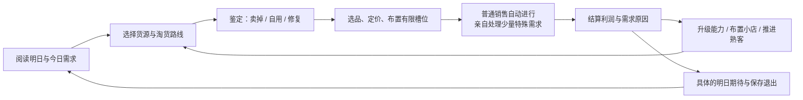

# 《咩咩与月灯巷》游戏设计探索 v0.1

英文工作名：MeeMee & Moonlantern Lane。日期：2026-10-25。

本文件是后续 agent 的设计起点。题材方向已明确，以下规则、内容量和所有数值均为建议初值，尚未实现或试玩。优先验证经营乐趣，不能把篇幅当成设计已经成立。

## 1. 定位与边界

一句话：咩咩在魔法学校附近经营一家奇物店，把淘到的古怪东西变成好生意，也把小店变成自己的家。

体验目标：发现时好奇，准备时有计划，营业时看到自己的判断生效，收工时满足并期待明天。

目标玩家：喜欢模拟经营、积累、收集和生活氛围的咩咩。她对实时压力、探索战斗、装修的偏好未确认，提供可调节节奏，不默认她喜欢硬核操作。

魔法参考《哈利波特》的隐藏街巷、学校日历、会动的日用品与温暖古怪的生活。使用原创学校、组织、货币和角色。具体角色、地名、学院体系、音乐和视觉标识不纳入素材需求。

开发约束：agent 负责代码、数据、文案、美术整合及验证；初期单人、离线、本地存档。运行时无大模型依赖。人类只需试玩反馈与必要的产品决定，无需进入编辑器配置场景。

## 2. 核心循环：两个环，一次反馈

**短环（数十秒）：**观察需求→挑选商品或搭配→反馈匹配原因→成交、金币与顾客反应。普通售货不重复确认。

**日环（目标 8–12 分钟，可暂停）：**阅读预告约 30 秒，淘货 2–3 分钟，整备 1–2 分钟，营业 3–4 分钟，结算与升级约 1 分钟。不是硬计时指标，需实测调整；第一天应更短。

**中环（2–3 日）：**买到改变操作或选择的设备、组成一个经营搭配、完成一次熟客委托。

**章环（七日）：**筹办开学夜市，证明一种经营路线，解锁下一阶段货源。无强制破产，无整档重置。

每个新系统必须回答：改变了哪一个日常决策？使用哪个已有输入？产出如何回流经营？答不出则延后。

## 3. 白天淘货：用选择产生惊喜

首版为小场景/节点路线，不做动作战斗。每日有 3 点外出行动，选择旧货摊、屋顶温室、学校失物招领三个货源；首日只开放旧货摊。每个节点耗 1 点，不使用真实时间等待。

进入前显示可能类别、成本和主要风险。节点内可见 2–3 个候选，有限资金/背包迫使取舍。基础采购价和类别稳定；特殊属性带变化。基础材料始终可以买到，不让随机商人锁住进度。

背包初值 6 格，相同普通原料可堆叠。选择稀奇物会占用可能用于畅销货的格子。界面显示剩余行动、资金和占格；购买前预览。路线升级带来新类别/额外调查，不只是容量翻倍。

七日切片中的关键首件奇物由脚本保证出现，其余从带种子的池中选出。关键剧情物不会误卖，普通收藏出售后有可解释的再次获得渠道。

## 4. 奇物设计：同一个东西有三种价值

每种奇物至少承担两种用途：可出售、可作为功能设备、可满足特殊委托。并非每件物品都同时拥有所有用途。

| 例子 | 售卖用途 | 留用/加工用途 | 决策 |
|---|---|---|---|
| 自搅拌小坩埚 | 学生采购 | 解锁自写笔等额外加工配方 | 今天现金还是明天省力 |
| 打盹羽毛笔 | 文具商品 | 配清醒墨水成为自写笔 | 直接卖还是投入材料升级 |
| 雨光苔 | 草药商品 | 制作防潮护符 | 平日卖还是为雨天备货 |
| 回声铃 | 奇物商品 | 放入陈列槽吸引收藏客 | 占槽获利还是变现扩建 |
| 暖月灯 | 家居商品 | 与夜光类商品形成搭配 | 大众商品还是专营路线 |

鉴定玩法：看外观描述和一条可测试反应，在最多三个性质中作判断。失败消耗少量当天调查机会，不销毁物品；自动保存已知线索。初期不靠背诵世界观，正确线索必须在游戏内可查。

修复采用“选择材料/方案→预览产物→完成”的数据规则。首次发现可有短演出；已知配方默认一键批量执行，不依赖任何设备或升级。坩埚只扩展可加工配方，不控制批量操作权限。首版不做研磨、旋转、描线等独立操作小游戏。

## 5. 营业：自动成交承托少量关键判断

货架 3 类商品位；功能奇物槽初始 2 个，后续 3 个。货架容量与功能槽是不同约束，UI 分开。点击/键盘选取即可操作，不要求小角色反复跑到收银台。

普通顾客由状态机执行进店、浏览、选择、付款、离开，自动完成交易。每晚约 6–8 位普通顾客与 1–2 位特殊顾客；首日人数更少，首个特殊需求必须出现。特殊顾客停在独立咨询区；对话时暂停营业时钟。普通客流有明确剩余人数，不用空等凑满时长。

特殊需求例：“我想要能在雨里继续记笔记的东西，预算 30。”玩家可交防潮护符或防水笔，不只有一个写死答案；满足必需标签即可成交，额外偏好影响反馈或关系。已知偏好自动记录。默认无限思考时间；不匹配先解释缺少的属性，允许取消，无永久惩罚。

定价首版用三档：亲民 0.9、标准 1.0、精品 1.15。显示成本、标价、预计毛利及目标客群；未知商品显示参考区间，鉴定后缩窄。避免像素精度调价和盲猜唯一最优价。

## 6. 有边界的组合：聪明经营，而不是无限乘法

候选组合：

- **雨夜文具铺：**雨天预告＋防水笔＋防潮陈列，提高对应客群的匹配率。
- **温暖家居铺：**暖月灯＋夜光类陈列＋居民客群，提高该类订单价值。
- **奇物精品铺：**鉴定设备＋少量稀奇物＋收藏客，更高单笔毛利，库存周转较慢。

首个切片只实现两条有效路线（文具与家居），收藏路线留作后续。效果分成：需求匹配、产能、处理便利、结算加成。每次成交显示最多三项增益及来源，动画可加速。

同类加成相加，避免乘算失控；每日活动价格影响上限 +25%，设备收益影响上限 +20%。这些是独立上限，不意味着同时必然给满。带来额外顾客的效果只改变客群分配或在固定总人数上限内补充，不无限刷客。

某商品高利润受客群需求数量限制。不能靠无限生产同一商品覆盖所有订单；也不引入不透明的强制通胀对抗玩家。

## 7. 经济模型与一日账本

先只保留金币、库存、行动点、关系里程碑。声望只作章节解锁条件候选，不在原型叠加多种货币。

示例规则（待测）：

- 成交标价＝基础价 × 定价档 ×（1＋活动价格加成），整数四舍五入。
- 顾客先按用途/必需标签匹配，再检查预算；精品档不保证被购买。
- 客群需求由日程定义，随机数只在合理范围选客人，不每帧掷骰拒买。
- 设备金币奖励在结算单列，与销售收入分开，不参与价格与预算计算。
- 毛利＝销售收入－已售商品成本；现金变动＝收入＋奖励－本日采购－本日费用－升级支出。两者不混用。
- 功能奇物装配后不再占可售库存；若允许拆卸，必须移回同一个实例，不能凭空复制。

**可复算例：**期初现金 100、库存 0；采购 4 支羽毛笔各 10、2 盏暖月灯各 20，共花 80，余 20。标准价分别 18、32。当天顾客全部有足够预算和对应需求，卖出 3 支笔与 2 盏灯，收入 118；费用 8；结末现金 130、库存 1 支笔（成本 10）。已售成本 70，毛利 48，扣费用后的经营利润 40；现金只增加 30，因为还有 10 留在库存。不包含活动、设备奖励或升级。

第一项功能升级参考价格 60–80，应在约两个正常营业日可达；首次允许选择加工配方扩展或额外陈列。装修从 10–30 起，可见但不强迫购买。以上需要至少三种采购策略的模拟，不得直接作为最终平衡。

资金软锁保护：永远保留一个零采购成本、低收益的回收委托；清楚标注每日次数，可攒出基础货款，不能无限刷。基础滞销货可按已知回收价变现。失败不制造负债死循环。免费应急路径不产稀有物品，避免成为最优主策略。

## 8. 成长、人物与生活感

成长至少有三种可见结果：店面变好看；旧工作省力；经营可选方案增多。若升级只写 +5%，原型阶段删除或改写。

六位熟客为后续目标，七日切片先做三位：急着开学的学生、修补旧物的邻居、收藏月光物件的老师。每位只有两段短事件、一个偏好和一个明确奖励，奖励优先是货源、配方或帮助。

关系通过满足特殊需求和主动协助提升，不要求每日机械送礼。事件在店内或结算后可选阅读；收工先保存，不因突然插入长剧情阻止退出。对话可回看。

店铺神秘线：旧账本上有一笔尚未完成的订单。七日内只出现一个线索和一个小回报，不强行解答整个世界。主线不能成为经营升级的隐形硬门槛。

## 9. 七日切片：先证明变化，不堆物量

| 日 | 当天新增 | 关键选择 | 收工留下的具体期待 |
|---|---|---|---|
| 1 | 购买、鉴定、上架、首个特殊需求 | 坩埚卖出或留用；未拿到也有普通路径 | 第一项可见升级、明日货源预告 |
| 2 | 已知配方批量生产 | 产能升级或陈列升级 | 已预告的雨天需求 |
| 3 | 雨天与多解需求 | 用备货兑现判断，保留备用货 | 温室开放与一种新材料 |
| 4 | 第二条经营路线 | 文具周转或家居毛利 | 首次熟客回访与订单 |
| 5 | 助手/等效自动化功能 | 腾出注意力处理特殊订单 | 夜市需求提前两天公布 |
| 6 | 活动整备 | 两种订单只能优先备足一种 | 自己布置的小店参加夜市 |
| 7 | 夜市阶段结算 | 用成熟路线完成一项目标 | 章节完成，可自由营业或结束 |

表中日期是节奏目标。设备付费解锁允许延迟，但第 5 日展示自动化可采用免费试用，确保验证环节不被经济失败跳过；奖励来源和持续期限须透明。

量级上限：1 个店面、3 个淘货节点、12 种可交易商品/材料（含加工产物）、4 条加工规则、4 种功能升级/设备、3 位熟客、2 类普通客群、2 套经营路线、1 次天气活动与1次夜市。详细 12 项清单由实现 agent 在写数据前补齐，并验证每种有用途和来源。

切片不包含自由大地图、战斗、多人、宠物养殖、四季、无限任务、大量独立小游戏、完整房屋编辑器。装饰先做有限插槽与换肤。

## 10. 上头的验证：主观目标与客观代理分开

**功能验收：**能完整走过七日；失败后可继续；每笔交易可解释；升级影响次日行为；同种子可复现；暂停和存档不丢状态。

**可观测代理：**记录玩家/测试代理做过哪些选品、升级、商品留用与路线切换。连续三日全卖最高价商品也最优，说明系统需要修改。完成同样营业量时，已掌握生产/补货的重复输入应下降。

**人类试玩：**不提示“继续玩”，在第三日收工提供明确退出和继续；观察她是否主动继续，并询问想验证什么。用“我想试这个搭配/明天会开花/想完成订单”的具体理由，区分对赠礼的礼貌称赞。一次试玩只是定性线索，不计算留存率。

**失败处理：**不想淘货→缩短节点、提高选择差异；不关心经营→让订单回流升级；只刷一种物品→调整客群与机会成本；觉得忙→默认自动化并降低普通订单数量；觉得空→压缩等待和教程，不先加系统。

不靠现实签到、离线惩罚、错过永不再来的礼物维持时长。随时暂停、明确收工和保存，是体验规则。

## 11. 视听与交互

视觉方向：暖琥珀灯光、靛蓝夜色、旧木与黄铜、羊形小标志；避免把魔法仅表现成粒子闪光。第一件奇物就要有可辨认的小动作。

建议 2D 固定店铺视角配操作面板：左侧货架/装配，中间店内反馈，右侧需求与手册，底部当天预告。支持点击选择再点击放置；拖拽作为可选捷径，不能是唯一操作。

数字、颜色、图标共同传达状态。顾客需求、库存不足、利润、暂停状态必须可读。中文字体、长文本溢出、小尺寸图标和缩放要实测。音效服务发现、成交、升级三类反馈；不让金币音效盖过背景音乐。

美术先一张风格基准和少量样本，通过后才批量生成。生成图逐张登记来源与处理方式；边缘、尺寸、透明背景和方向一致性纳入验收。没有合适音乐时使用安静环境声或合法本地资源占位，不自动购买素材或开通付费服务。
